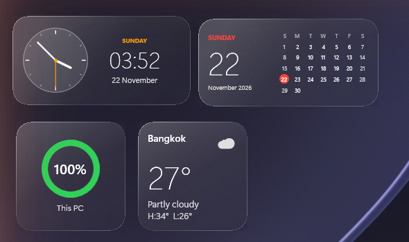
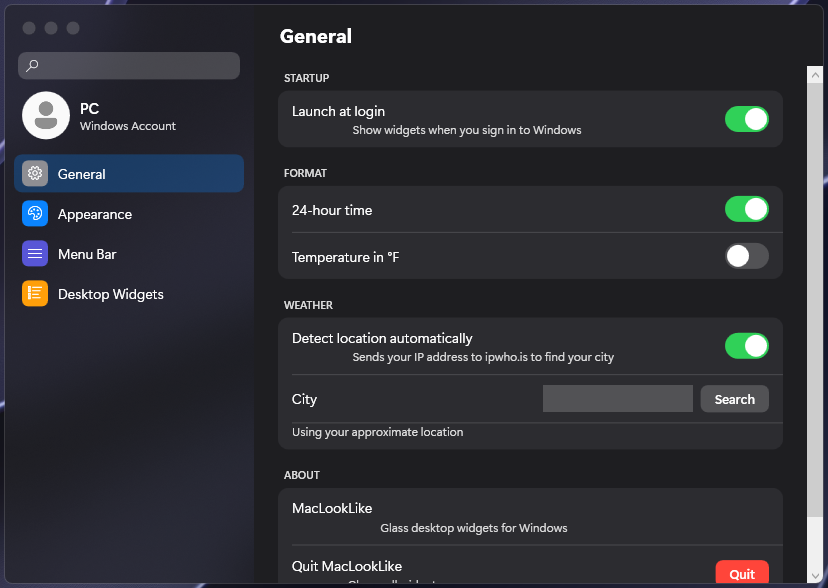

# MacLookLike

macOS-style liquid-glass desktop widgets for Windows. Widgets sit on the desktop and slip under your app windows, just like on a Mac.



## Features

- Translucent glass widgets: Clock, Calendar, Weather, Battery
- Small / Medium / Large sizes and several styles per widget
- Drag widgets to move them
- Battery widget shows connected Bluetooth devices
- Right-click a widget → **MacLookLike Settings**
- Single `MacLookLike.exe`, no installer



## Run

Download `MacLookLike.exe` from [Releases](../../releases) and run it. Settings opens on first launch. Run it again at any time to reopen Settings.

## License

[MIT](LICENSE)

## Build

Needs only the .NET Framework 4.8 compiler that ships with Windows:

```powershell
./build.ps1
```
